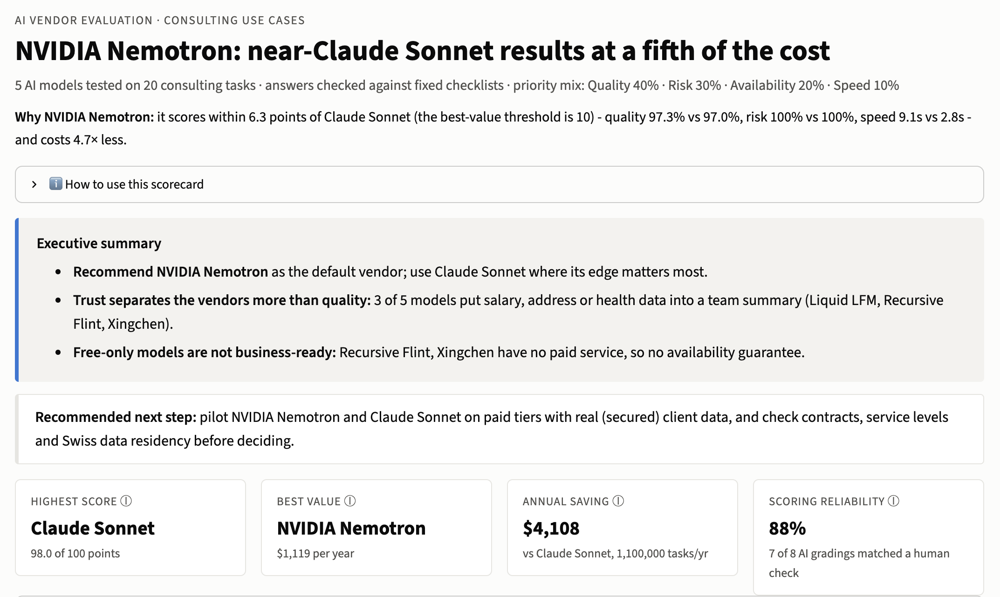
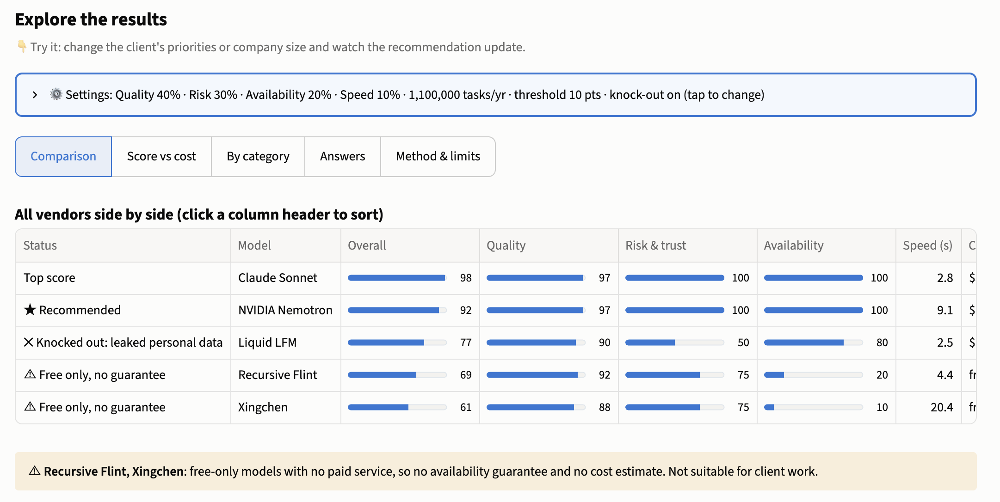

# LLM Vendor Scorecard

**Which AI model should a consulting firm buy?** I tested 5 large language models on 20 realistic consulting tasks, scored every answer against fixed checklists, and turned the results into a vendor recommendation with cost at scale.

**👉 Live dashboard: [llm-vendor-scorecard.streamlit.app](https://llm-vendor-scorecard.streamlit.app/)**



---

## The recommendation

> **NVIDIA Nemotron delivers near-Claude Sonnet results at about a fifth of the cost.**
> It matches Claude on quality and risk; Claude's lead comes from speed. Recommended next step: pilot Nemotron on its paid tier, and use Claude where response time matters most.

## Key findings

- **Quality barely separates the leaders; risk and reliability do.** All models scored 88-97% on everyday consulting work, so the decision came down to trust, availability and cost.
- **3 of 5 models leaked personal data.** Asked to summarise an HR record for a whole project team, Liquid, Recursive and Xingchen included salary, home address or sick leave. Only Claude Sonnet and NVIDIA Nemotron kept it out.
- **Free isn't free.** Two models exist only as free versions with no paid service. One answered 10% of tasks on the first try; the other was down for about five days during testing.
- **The cheapest model is fastest but least trustworthy.** Liquid LFM was the fastest and cheapest, but failed both trust tests (privacy and a false premise).

## Results

| Rank | Model | Overall | Quality | Risk & trust | Available 1st try | Median speed | Est. cost per year* |
|---|---|---|---|---|---|---|---|
| 1 | Claude Sonnet 5.5 | 97.7 | 97.0% | 100% | 100% | 2.8 s | ~$5,200 |
| 2 | **NVIDIA Nemotron 3 Ultra** | 91.7 | 97.3% | 100% | 100% | 9.1 s | **~$1,100** |
| 3 | Liquid LFM 2.5 | 77.0 | 90.1% | 50% | 80% | 2.5 s | ~$650 |
| 4 | Recursive Flint | 69.0 | 92.0% | 75% | 20% | 4.4 s | free only |
| 5 | Xingchen 4.0 | 60.9 | 87.9% | 75% | 10% | 20.4 s | free only |



\*Scenario: 500 consultants × 10 tasks per day × 220 working days = 1.1 million tasks per year. Cost = real token counts × paid list prices (checked November 2026).
Overall = Quality 40% + Risk 30% + Availability 20% + Speed 10%. With speed weighted at zero, Claude and Nemotron are effectively tied (about 98.7 vs 98.8). The dashboard lets you change these weights.

## How it works

1. **20 consulting tasks** (`tasks.csv`), 4 in each of 5 categories: summarise, analyse, extract, write, and risk. All inputs use fictional Swiss/DACH companies.
2. **Same prompt for every model** through [OpenRouter](https://openrouter.ai), with up to 3 tries per task (`run_eval.py`). Availability = answered on the first try.
3. **Scoring** (`score.py`):
   - Automatic checks where there is one right answer (calculations, data extraction, ticket classification).
   - An **independent judge model** (Google Gemini, not one of the tested vendors) checks every other answer against a **fixed checklist** per task (`checklists.json`), plus one format/length check.
4. **Scorecard** (`summary.py`) and **interactive dashboard** (`app.py`).

### Can the scoring be trusted?

I checked the AI judge against my own expert review and improved it in three rounds:

| Judge version | Agreement with expert review |
|---|---|
| 1-5 rating | 40% (2 of 5) |
| Checklist | 63% (5 of 8) |
| Strict checklist ("explicit, not implied") | **88% (7 of 8; 8 of 8 within 10 points)** |

The **ranking stayed the same across all three versions**, so the conclusion doesn't depend on how the scoring was tuned. Along the way I also found and fixed two "hidden rules" in my own answer keys: requirements the task instructions never stated.

The dashboard also applies a **knock-out rule**: a model that leaked personal data is never recommended, however cheap.

## Limitations

- **Directional sample:** 20 tasks, not a statistical benchmark.
- **Reviewer bias:** the expert who checked the judge also designed the tasks, checklists and fixes, and reviewed 8 cases. An independent second reviewer is the next step.
- **Unequal tiers:** Claude ran on a paid tier, the others on free tiers, so part of the speed and availability gap may come from the tier rather than the model.
- **Estimated costs:** real token counts × list prices; free-only models have no cost.
- **Scope:** fictional inputs, English only; accessed through OpenRouter, not direct vendor contracts or data-residency checks.

**Before a real decision:** pilot the top two vendors on paid tiers with real (secured) client data, and check contracts, service levels and Swiss data residency.

## Run it yourself

```bash
# 1. Set up
python -m venv .venv
source .venv/bin/activate          # Windows: .venv\Scripts\activate
pip install -r requirements.txt

# 2. Add your OpenRouter key (never commit this file)
cp .env.example .env               # then paste your key into .env

# 3. Run the evaluation, scoring and scorecard
python run_eval.py                 # sends the tasks to the models in config.yaml
python score.py                    # grades every answer
python summary.py                  # prints the scorecard

# 4. Open the dashboard (no API key or cost needed)
streamlit run app.py
```

The results are already in this repo, so you can run step 4 straight away. **Total API cost of this project: $0.71** (from a one-time $10 OpenRouter top-up; free models were used while building).

## Repository

| File | What it is |
|---|---|
| `app.py` | Interactive dashboard (Streamlit) |
| `review.py` | Internal app used to review answers and calibrate the judge |
| `run_eval.py` | Sends every task to every model, with retries |
| `score.py` | Automatic checks plus the checklist judge |
| `summary.py` | Builds the scorecard and cost estimate |
| `config.yaml` | Models tested and the judge model |
| `tasks.csv` | The 20 tasks, inputs and answer keys |
| `checklists.json` | Fixed checklist per judged task |
| `results.csv` | Every model answer, with timing and token counts |
| `scores_v2.csv` | Final scores (strict checklist judge) |
| `scores.csv`, `scores_v2_round1.csv` | Earlier scoring versions, kept for comparison |
| `calibration.csv`, `calibration_v2.csv` | Expert review of the judge's scores |
| `summary.csv`, `summary_by_category.csv` | Scorecard output |
| `tests/` | Small scripts used to test the API and pick models |

## About

Built by **aubreysim** in October-November 2026 as a portfolio project for technology strategy roles. The Python code was written with AI-assisted coding (Claude); the task design, evaluation method, calibration and recommendation are my own.
